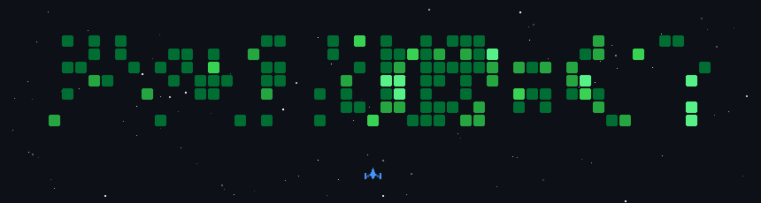

## 👋 Hello there!
 
- I'm **Sandhiya**! 🌸 A final-year Computer Science student, an occasional artist, and a full-time curious human. **Learning, building, breaking things, and fixing them again!** 🚀
- 🎨 I see art in everything! I don't sketch often, but when I do, it's with a pencil and a whole lot of happiness. Photography is my little hobby too 📷. I love noticing the light, the shapes, and the tiny details most people walk past.
- 🌱 I can't sit still, in the best way! I'm always up to something, mostly learning a new tech (even a small one!) and trying to understand how this big, wonderful tech world works. I'm still exploring, and I hope that never stops ✨

  

